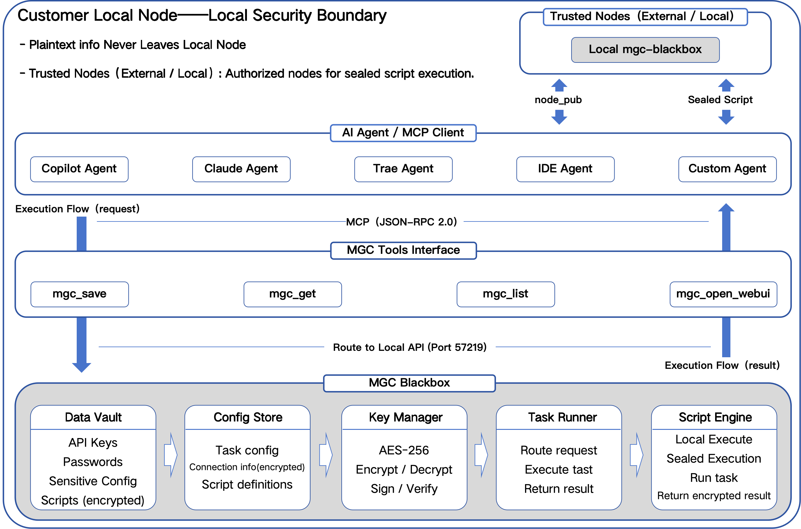

# **MirginCipher Blackbox (MGC)** — Multi-Agent Cross-Device Task Encryption, Execution & Delivery Tool

An encrypted task delivery and execution tool for **multi-agent, cross-device workflows** — sensitive operations never leave the device in plaintext; scripts, files, and skill / workflow folders can be encrypted, delivered, and executed across trusted devices without exposing source code.


> 📌 **Roadmap:** [MGC Blackbox — 2026 Development Plan](https://github.com/zkeviny/MGC-Blackbox/issues/4)
---

## **What is MGC Blackbox?**

MirginCipher Blackbox (MGC) is a **Multi-Agent Cross-Device Task Encryption, Execution & Delivery Tool**. It is **not an agent itself** — it is the encrypted task delivery and execution layer underneath your agents.

MGC provides:

- **100% local, never touches the cloud** — all data, scripts, and encryption keys stay on your device. No third-party servers, no telemetry.
- **Store** sensitive data (tokens, passwords, configs) and scripts (logic, workflows, automation).
- **Execute** stored scripts with structured args and auto-detected dependencies. No rewrites, no path tricks, no plaintext on disk.
- **Delegate across nodes** — seal a script into a portable JSON capsule, hand it to another MGC node, and let it run there. No plaintext crosses the boundary. p2p mode binds it to one node's key; free mode opens it to any node while keeping the source encrypted; chain mode splits one task into one sealed sub-package per node, each containing only that node's granted files.
- **Auto-recognize workflows** — MGC automatically discovers scripts' args, dependencies, compatible OS, and cross-script workflow relationships.
- **Open WebUI** for human operations.

---

## **Why MGC?**

- 🔐 **End‑to‑End Encrypted Storage**  
  AES‑256 encrypted vault for API keys, credentials, configs — never exposed to AI agents or external systems.

- 🧱 **Local‑First Security Boundary**  
  All execution and decryption happen on‑device. No cloud dependency, no plaintext leakage, no telemetry.

- 🧩 **Sealed Script & Folder Execution (Unique)**  
  Convert scripts, files, and skill / workflow folders into unreadable execution capsules.  
  **p2p mode** binds the capsule to one node's key; **free mode** opens it to any MGC node while keeping the source encrypted. Neither the recipient nor a third party can read the source.

- ⚡ **Deterministic Local Execution**  
  Stable, reproducible behavior across macOS / Linux / Windows with a Cython‑compiled secure core.

- 🛠️ **Native MCP / Skill Integration**  
  Exposes mgc_save / mgc_save_file / mgc_get / mgc_list / mgc_run / mgc_find / mgc_seal / mgc_seal_package / mgc_package / mgc_delete / mgc_open_webui / mgc_skill as standard MCP tools.  
  Works out‑of‑the‑box with Copilot, Claude, Trae, IDE Agents.

- 🔄 **Zero Integration Cost**  
  Any MCP‑compatible agent can immediately use MGC as its secure execution backend — no SDK, no custom code.

- 🛡️ **Designed for AI Agent Security**  
  Protects human intent, prevents agent overreach, and enforces strict execution boundaries.

---

## **Use Cases**

### **1. Protect API Keys & Credentials from AI Agents**  
Store secrets encrypted in MGC. Scripts retrieve values at runtime by name — no plaintext in source code. The values are only released inside MGC's encrypted execution boundary.

### **2. Path-Independent Script Addressing**  
Address scripts by MGC location name, not hardcoded file paths. The same name resolves on any machine where MGC has the entry.

### **3. Source Code Protection**  
Store scripts in MGC. The source stays encrypted on disk; an authorized node can execute it, but the plaintext is never exposed.

### **4. Cross-Node Delegation Without a Cloud Broker**  
Authorize another machine to run your script via local key exchange + sealing. No cloud trust broker, no third party — you only need the target machine's public key.

### **5. Multi-Script Workflow Portability**  
Save a folder of scripts that call each other via `import` / `subprocess`. MGC auto-discovers call relationships and routes them at runtime — no source files needed on the target machine.

### **6. Node-Bound Execution (No Re-Sealing)**  
Sealing binds the script to the recipient's device key. Only that device can decrypt and execute; the recipient cannot re-seal for someone else.

### **7. Public Skill Distribution (Free Mode)**  
Publish a skill to a marketplace or community via free mode — seal without specifying a recipient. Any MGC node can execute, but the source never touches disk and cannot be read.

### **8. One Task, Many Nodes (Chain Mode)**  
Split one orchestrated task into one sealed sub-package per node — each node receives only the files it was granted, and can decrypt and run only those. A machine-readable distribution index makes automated dispatch straightforward.

---

## 📘 **Value Scenarios**

MGC Blackbox provides a **trusted, encrypted execution boundary** for different roles and environments.  
Detailed scenario documents:

- 🔐 **Sensitive Credentials Authorization**  
  [docs/Sensitive_Credentials_Authorization.md](docs/Sensitive_Credentials_Authorization.md)

- 🧠 **Encrypted Cognitive Script Execution**  
  [docs/Encrypted_Cognitive_Script_Execution.md](docs/Encrypted_Cognitive_Script_Execution.md)

- 🌐 **Cross‑Node Execution Grant (Encrypted Capability Sharing)**  
  [docs/Cross‑Node_Execution_Grant%20(Encrypted_Capability_Sharing).md](docs/Cross‑Node_Execution_Grant%20(Encrypted_Capability_Sharing).md)

---

## **Architecture**

<p align="center">
  
</p>

---

## **Crypto Layer & Performance**

MGC uses a **hybrid cryptographic design**:

- **AES‑256‑GCM** — bulk data encryption  
- **RSA‑2048/4096** — key encapsulation & node authorization  

The crypto layer is **Cython‑compiled** to:

- Improve AES & RSA performance  
- Reduce Python overhead  
- Provide a sealed, tamper‑resistant execution boundary  
- Maintain deterministic behavior across nodes  

---

## **Features**

- Local encrypted storage  
- Encrypted execution  
- Store‑once authorization  
- Environment migration  
- Cross‑agent availability  
- Cross‑platform support  
- Script sealing for cross‑node execution (p2p + free mode)  
- **Chain mode** — one task, one sealed sub-package per node (`mgc_seal_package` with a JSON array of targets); includes a machine-readable distribution index for automated dispatch  
- Cross-script auto-recognition in skill / workflow folders — `mgc_save_file` parses the script call graph (`import` / `from-import` / relative-path subprocess) at save time; `mgc_run` then routes cross-script calls through sealed execution transparently.  
- Sealed capsule import — `mgc_seal` writes a self-describing JSON capsule; any MGC node can import and run it.

---

## **Quick Start**

### **1. Install**

```bash
pip install mgc-blackbox
```

### **2. Start Service**

```bash
mgc
```

### **3. Open WebUI**

```
http://127.0.0.1:57218
```

REST API available at `http://127.0.0.1:57219`.

### **4. Store a Secret**

```python
from mgc import save
save("openai_key", "sk-xxxx")
```

### **5. Execute Scripts Securely**

Scripts run inside MGC's encrypted boundary.

---

## **Example: Save & Retrieve Secrets**

```python
from mgc import save, get

save("openai_key", "sk-xxxx")
print(get("openai_key"))
```

---

## **MCP Integration**

MGC exposes a local MCP tools interface:

- `mgc_save` — store a single secret / script / file by explicit content  
- `mgc_save_file` — store by local file path; auto-detects single file vs folder; also auto-recognizes cross-script calls inside folder saves (`import` / `from-import` / relative-path subprocess)
- `mgc_get` — retrieve encrypted content  
- `mgc_list` — browse stored entries  
- `mgc_run` — execute a stored script in the encrypted boundary; cross-script calls inside a folder run transparently as sealed child processes  
- `mgc_find` — fuzzy-search entries by `info_owner` / `diff_1..3` (no `info_type`)  
- `mgc_seal` — seal a single script into a portable JSON capsule for cross-node delegation  
- `mgc_package` — bundle a folder into a plaintext export archive  
- `mgc_seal_package` — ship a sealed package to a trusted node (single PEM), to any node (free mode), or to many nodes at once (chain mode: JSON array of targets)  
- `mgc_delete` — delete a stored record (permanent, audited)  
- `mgc_open_webui` — open the local WebUI  
- `mgc_skill` — return the bundled skill document (`skill_spec.md`) for the agent  

Compatible with Copilot, Claude, Trae, IDE Agents.

---

## **Usage Overview**

### **1. Through AI agents (Skills / MCP)**  
Agents can store secrets, retrieve encrypted items, execute scripts, and seal scripts.

### **2. Through system scripts (REST API)**  
External scripts can fetch encrypted items at runtime.

---

## **Security Model**

- All data remains local  
- No cloud upload  
- No plaintext logging  
- Deterministic execution  
- User‑controlled authorization  
- Sealed scripts can be executed on authorized nodes; the plaintext source is never exposed  
- Folder packages inherit single-script guarantees: every file encrypted, only file structure visible  
- **Scope of the guarantee**: MGC protects **content confidentiality**, not **runtime behaviour**. A sealed script runs with the full privileges of the user who runs it — MGC does not restrict which commands it invokes, which files it reads or writes, or which network endpoints it reaches. Treat a sealed capsule as executable code from an untrusted source.

---

## **AI Skill Specification**

See: `docs/skill_spec.md`

---

## **Authorization**

Integration into any third‑party products or AI agents is free,  
but requires official authorization to ensure ecosystem integrity.

Contact: **mirgincipher@outlook.com**

---

## **License**

See the LICENSE file for full terms.

© 2026 MirginCipher Team. All rights reserved.
```

---
